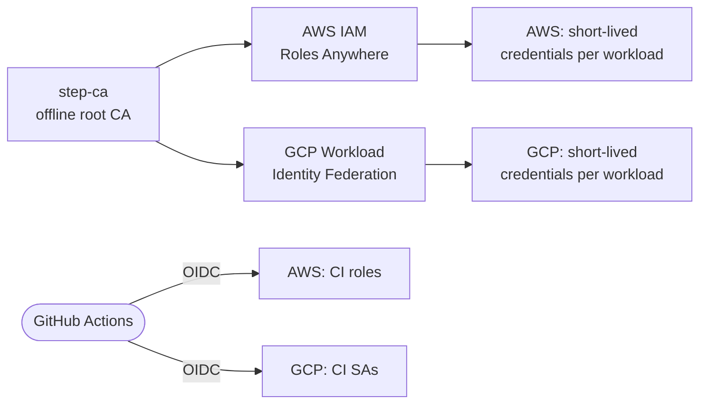

# skylab-terraform

AWS and GCP foundations that must exist before any cluster can use either cloud: GitHub Actions OIDC roles, IAM Roles Anywhere trust anchor, GCP Workload Identity Federation, object storage buckets for Loki / Tempo / TechDocs, and the Proxmox qdevice.

This is the **static foundation** for the Skylab platform — anything a cluster needs that lives outside a cluster. Dynamic cloud resources (EKS, VPCs, databases) are rendered from inside the cluster by [skylab-crossplane](https://github.com/SkylarHoughtonGithub/skylab-crossplane). The two never overlap.

## Design decisions

**One step-ca root, two clouds.** AWS via IAM Roles Anywhere using step-ca as the trust anchor; GCP via Workload Identity Federation — step-ca X.509 certs for hub workloads, a separate OIDC pool for GitHub Actions. The same step-ca root is trusted by both clouds.

**No static credentials anywhere.** The target state has zero static AWS or GCP keys in the Skylab footprint. Every workload authenticates through short-lived credentials — Roles Anywhere on AWS, WIF on GCP, OIDC for GitHub Actions.

**Modules and stacks, not environments.** `modules/` holds reusable composition units; `stacks/` holds one-off deployables with their own state. No `envs/dev` folder.

## Trust story



## Stacks

One deployable per stack, each with its own state.

| Stack | Role |
| --- | --- |
| [`bootstrap/`](stacks/bootstrap/) | S3 bucket for Terraform remote state across every other stack. Uses native S3 lockfile locking (Terraform ≥ 1.11) — no DynamoDB. One-time apply. |
| [`identity/`](stacks/identity/) | Account-wide identity: the GitHub Actions OIDC provider (singleton per AWS account) and the CI roles each sibling repo uses to deploy. |
| [`gcp-identity/`](stacks/gcp-identity/) | GCP mirror: one project with the APIs Skylab needs, Workload Identity Federation pool, and CI service accounts. |
| [`storage/`](stacks/storage/) | Object storage for cluster-side consumers: Loki chunks (90-day GLACIER_IR), Tempo traces, TechDocs. |
| [`roles-anywhere/`](stacks/roles-anywhere/) | Roles Anywhere trust anchor rooted at the step-ca offline root, plus one profile + role per workload that needs short-lived AWS credentials. |
| [`crossplane/`](stacks/crossplane/) | Scoped IAM policy for Crossplane's `provider-aws`, used by the `crossplane_aws` role in `roles-anywhere/`. |
| [`qdevice/`](stacks/qdevice/) | External Proxmox corosync vote arbiter (QDevice) run as an ECS Fargate service so the Proxmox cluster holds quorum across an even node count without a dedicated third host. |

## Modules

Reusable building blocks. All named with a `<cloud>-<role>` prefix.

| Module | Used by |
| --- | --- |
| [`aws-github-oidc/`](modules/aws-github-oidc/) | `stacks/identity` for the OIDC provider + per-repo CI roles |
| [`aws-roles-anywhere/`](modules/aws-roles-anywhere/) | `stacks/roles-anywhere` for the trust anchor + per-workload profiles |
| [`aws-object-storage/`](modules/aws-object-storage/) | `stacks/storage` for each bucket (lifecycle rules, encryption, versioning) |
| [`aws-ecs-service/`](modules/aws-ecs-service/) | `stacks/qdevice` for the Fargate service |
| [`gcp-workload-identity/`](modules/gcp-workload-identity/) | `stacks/gcp-identity` for the WIF pool + bindings |

## Local dev

Requires **Terraform 1.11.4** (matches `TF_VERSION` in CI) and credentials for the target cloud account.

```sh
cd stacks/<stack>
terraform init
terraform plan
terraform apply
```

Each stack's own `README.md` carries per-stack prerequisites, outputs, and any manual steps.

## CI

Every PR and every merge runs four jobs across the whole tree:

| Job | What it checks |
| --- | --- |
| **`terraform fmt`** | `-recursive -check -diff` across `modules/` and `stacks/` |
| **`terraform validate`** | `init -backend=false` + `validate` per stack |
| **`tflint`** | Per-directory lint on every module and stack |
| **`trivy (IaC)`** | HIGH + CRITICAL IaC misconfigurations across the tree |

Plan + apply on merge run through the OIDC role from `stacks/identity`.

## Cross-repo map

| Repo | Consumes from here |
| --- | --- |
| [skylab-gitops](https://github.com/SkylarHoughtonGithub/skylab-gitops) | Loki + Tempo buckets (`storage/`), Roles Anywhere profiles (`roles-anywhere/`) for short-lived AWS credentials inside the cluster |
| [skylab-crossplane](https://github.com/SkylarHoughtonGithub/skylab-crossplane) | `provider-aws` IAM policy (`crossplane/`) |
| [skylab-backstage](https://github.com/SkylarHoughtonGithub/skylab-backstage) | TechDocs bucket (`storage/`), Gitea OIDC values, step-ca trust bundle |

## Where to go next

- **[`plan.md`](plan.md)** — full rework plan, remaining follow-ups (tightened scaffold policies, qdevice container port, retiring `terraform/development/`).
- **[`AGENTS.md`](AGENTS.md)** — engineering context for coding agents.
- **[`scripts/skylab-ca.sh`](scripts/skylab-ca.sh)** — the step-ca root CA management script referenced by `stacks/roles-anywhere` and the GCP WIF identity story.

> Legacy content under `terraform/development/` predates the rework and is kept only as migration source material.
